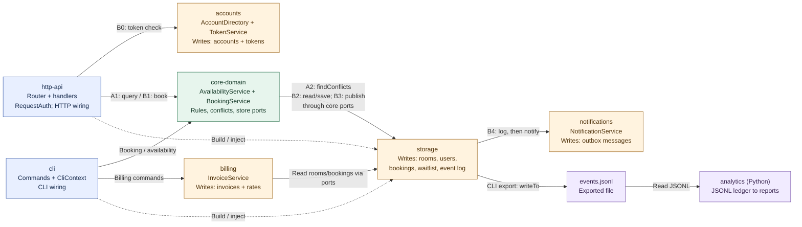
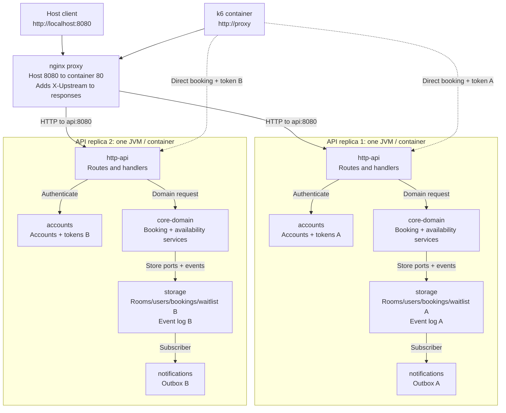

# BOUNDARIES.md

One section per milestone. Fill them in in order (the sketch before you write
anything about it, the copies next, the proposal last).

Draw Milestone 1's sketch from the code. A TA may ask where each arrow came
from.

Keep it short and specific. Point at modules, files, and callers.

---

## Milestone 1: The architecture as built

**The sketch.** Boxes are code modules, except for the exported JSONL file.
Solid arrows show runtime calls or data flow; dotted arrows show construction
and injection. A = availability; B = a new booking. Return paths are omitted.



**A: availability.** `GET /rooms/{roomId}/availability` -> `Router` ->
`RoomsHandler.availability` -> `RoomCatalog.find` (room lookup), then
`AvailabilityService.freeOnDate` -> `freeIntervals` -> `busyIntervals` ->
`BookingStore.findConflicts` -> `InMemoryBookingStore.findConflicts`.
The store checks interval endpoints directly; this path does not call
`ConflictChecker` or `TimeInterval.overlaps`. The handler also asks for booked
minutes and utilization, which use the same store query, and formats the reply.

**B: booking.** `POST /bookings` -> `Router` -> `BookingsHandler.create` ->
`RequestAuth.require` -> `AuthorizationService.authenticateHeader` ->
`TokenService.find`. After authentication, `BookingService.requestBooking`
reads the room and user, checks `BookingRules` and the user's limits, then uses
`ConflictChecker` -> `TimeInterval.overlaps` on the room's active bookings.
A free slot leads to `BookingStore.save` -> `InMemoryBookingStore.save`, then
`EventPublisher.publish` -> `EventLogPublisher.publish` -> log append ->
`NotificationService.publish` -> `InMemoryOutbox.enqueue`; the handler returns
201. A room conflict can instead save a waitlist entry and return 202, without
publishing a creation event. Rule or user-limit failures reject the request.

**State and wiring.** The `storage` box denotes implementation code, not a
shared database: `CampusReservePlatform` and `CliContext` each construct a fresh
`StoreRegistry.inMemory()`. Each HTTP platform also constructs its own accounts,
tokens, and notification outbox; CLI billing constructs its own invoice store.
`RoomCatalog` and `UserRegistry` write room/user records through ports, and HTTP
startup also copies accounts into `UserStore` via `AccountDirectory.syncInto`.
Notifications find recipients through `AccountsUserDirectory`, an adapter in
`http-api` implementing the notifications-owned `UserDirectory` port. The
subscriber call is synchronous, with failures isolated from the stored booking.
The JSONL export shown belongs to the CLI's log; the default HTTP wiring does
not persist or export its log. A file-backed event-log implementation also
exists in `storage`, but neither default entry point selects it.

<details>
<summary>Compile-time dependencies and code checks behind the sketch</summary>

Runtime calls through a port do not reverse a compile-time dependency:
`core-domain` declares the store interfaces and `storage` implements them.
The module POMs declare these dependencies (checked independently of the diagram
in `ARCHITECTURE.md`):

| Module | Direct Java module dependencies |
|---|---|
| `core-domain` | none |
| `storage` | `core-domain` |
| `accounts` | `core-domain` |
| `notifications` | `core-domain` |
| `billing` | `core-domain`, `storage` |
| `http-api` | `core-domain`, `storage`, `accounts`, `notifications` |
| `cli` | `core-domain`, `storage`, `billing` |
| `analytics` | none; reads the exported JSONL contract |

Code checks performed for this draft:

- **HTTP wiring and local state:** read the constructor and `buildRouter` in
  [CampusReservePlatform.java](http-api/src/main/java/edu/cmu/cs214/campusreserve/http/CampusReservePlatform.java),
  plus [StoreRegistry.java](storage/src/main/java/edu/cmu/cs214/campusreserve/storage/StoreRegistry.java).
- **A:** followed `availability` in
  [RoomsHandler.java](http-api/src/main/java/edu/cmu/cs214/campusreserve/http/RoomsHandler.java),
  the service calls in
  [AvailabilityService.java](core-domain/src/main/java/edu/cmu/cs214/campusreserve/core/service/AvailabilityService.java),
  and the endpoint comparisons in
  [InMemoryBookingStore.java](storage/src/main/java/edu/cmu/cs214/campusreserve/storage/InMemoryBookingStore.java).
- **B:** followed `create` in
  [BookingsHandler.java](http-api/src/main/java/edu/cmu/cs214/campusreserve/http/BookingsHandler.java),
  authentication through
  [RequestAuth.java](http-api/src/main/java/edu/cmu/cs214/campusreserve/http/RequestAuth.java),
  and `requestBooking` in
  [BookingService.java](core-domain/src/main/java/edu/cmu/cs214/campusreserve/core/service/BookingService.java).
- **Event delivery:** checked the ordered calls in
  [EventLogPublisher.java](storage/src/main/java/edu/cmu/cs214/campusreserve/storage/EventLogPublisher.java),
  the outbox write in
  [NotificationService.java](notifications/src/main/java/edu/cmu/cs214/campusreserve/notifications/NotificationService.java),
  and the recipient adapter in
  [AccountsUserDirectory.java](http-api/src/main/java/edu/cmu/cs214/campusreserve/http/AccountsUserDirectory.java).
- **CLI and billing:** checked construction in
  [CliContext.java](cli/src/main/java/edu/cmu/cs214/campusreserve/cli/CliContext.java),
  the command-to-service call in
  [BookingCommands.java](cli/src/main/java/edu/cmu/cs214/campusreserve/cli/commands/BookingCommands.java),
  and the port reads and invoice writes in
  [InvoiceService.java](billing/src/main/java/edu/cmu/cs214/campusreserve/billing/InvoiceService.java).
- **Export and analytics:** followed
  [ExportEventsCommand.java](cli/src/main/java/edu/cmu/cs214/campusreserve/cli/commands/ExportEventsCommand.java)
  into `InMemoryEventLog.writeTo`, then read `load_events`, `build_ledger`, and
  `load_ledger` in
  [events.py](analytics/campusreserve_analytics/events.py)
  and the report entry point in
  [cli.py](analytics/campusreserve_analytics/cli.py).

These are source-inspection checks by the agent. They do not claim a running
two-copy experiment or the student's independent verification.

</details>

**Where your sketch and `ARCHITECTURE.md` disagree.** List at least two
places where your drawing and the repository's drawing are not the same
picture, each in one line. Include things you drew that it does not, and things it draws
that you did not.

**How you decided which one is right.** For each disagreement above, name the
check that settled it (the imports you read, the callers you listed, the wiring
you traced, the test that pins the behavior). "It looked that way" is not a
check, and neither is "the document says so". Your agent may produce the trace,
but check it before you rely on it.

---

## Milestone 2: Run it as copies

**What one replica contains.** The runtime stage of `Dockerfile` includes
`http-api`, `core-domain`, `storage`, `notifications`, and `accounts`. Each
`api` container starts one JVM running `CampusReserveServer`, which constructs
its own `CampusReservePlatform`. Two replicas run the same code and seed the
same initial rooms/users, but allocate separate accounts, tokens, stores, event
logs, and outboxes. This duplicates the HTTP application's execution; it does
not synchronize its data. The runtime image excludes `cli`, `billing`, and
Python `analytics`.

**Deployment view.** Each large API box is one container/process. Arrows
inside it are ordinary Java calls; arrows from nginx to an API are HTTP calls
across the container network. Dashed arrows are the booking script's direct
HTTP probes. Both replicas can run on the same Docker host.



There is no synchronization edge between A and B. A token issued by replica 1
is stored only in its token table; a booking saved there is visible only to its
own store queries. These are code-derived predictions for the two experiments,
checked by the runs below. `compose.yaml` publishes only the proxy's port, so
both API containers can listen on their own internal port 8080.

**Your stack.** Run from the repository root in PowerShell:

```powershell
docker compose up -d --build --scale api=2 api proxy
Start-Sleep -Seconds 6
docker compose ps
docker compose logs api
```

The initial `/health` smoke check made 40 successful proxy requests:
`172.18.0.2:8080` answered 19 and `172.18.0.3:8080` answered 21, so there
were **2 distinct `X-Upstream` values**. `docker inspect` mapped these to
`f26-lab09-api-1` and `f26-lab09-api-2`. Addresses can change on recreation.
The Java reactor gate passed in a disposable JDK 21/Maven container, and the
Python gate passed all 150 tests. No production code or shipped tests changed.

Read the fresh `u-1 (member)` token from replica 1 and `u-2 (admin)` token from
replica 2 into PowerShell variables. Run this again after restarting or
recreating the APIs:

```powershell
$api1Log = (docker logs f26-lab09-api-1) -join "`n"
$api2Log = (docker logs f26-lab09-api-2) -join "`n"
$token1 = [regex]::Match($api1Log, 'u-1 \(member\)\s+(\S+)').Groups[1].Value
$token2 = [regex]::Match($api2Log, 'u-2 \(admin\)\s+(\S+)').Groups[1].Value
```

Tokens are passed at runtime and are not saved in the repository. Use
`--no-deps` so starting k6 does not change the API service's scale.

### Finding 1: tokens

**The claim.** A currently valid token authenticates every request, whichever
API replica answers it.

**The script and its result.** [load/token-any-replica.js](load/token-any-replica.js)
runs 40 `GET /bookings` requests through the proxy with one VU:

```powershell
docker compose run --rm --no-deps -e "TOKEN=$token1" k6 run /scripts/token-any-replica.js
$LASTEXITCODE
```

Thresholds are `token_works_on_any_replica: rate==1` and
`distinct_upstreams: value==2`. The latter checks that the one VU's accumulated
set of upstream addresses contains both copies.

Observed on 2026-10-30 at 16:23 UTC:

| `X-Upstream` | Requests | Status |
|---|---|---|
| `172.18.0.2:8080` (replica 1) | 24 | 200 |
| `172.18.0.3:8080` (replica 2) | 16 | 401 |

The token success rate was **60%** and the upstream count was **2**. The token
threshold failed, so k6 exited **99**. The split is an observation, not an
assumption that the proxy must distribute requests evenly.
The automatic pass/fail criteria use k6's
[threshold expressions](https://grafana.com/docs/k6/latest/using-k6/thresholds/).

**Why, from the code.** `TokenService.byValue` is an instance-owned
`LinkedHashMap`. `CampusReservePlatform` constructs a new `TokenService` for
each process, and `CampusReserveServer` issues its own startup tokens.
Tracing `RequestAuth.require` -> `AuthorizationService.authenticateHeader` ->
`authenticate` -> `TokenService.find` showed that the second process searches
only its own map, where the first process's token is absent.

**The kind of problem.** Stateful replicas with process-local session state;
authentication is not independent of replica selection.

### Finding 2: bookings

**The claim.** Across all API replicas, one room/time slot is confirmed at most
once.

**The script and its result.** [load/slot-at-most-once.js](load/slot-at-most-once.js)
first counts `X-Upstream` values on 40 proxy `/health` requests. It then sends
two sequential booking requests directly to the named containers, each with
that container's own token. This isolates booking consistency from the token
failure. Different users (`u-1` and `u-2`) request the same `r-1` slot.

```powershell
docker compose run --rm --no-deps `
  -e 'API_1=http://f26-lab09-api-1:8080' `
  -e 'API_2=http://f26-lab09-api-2:8080' `
  -e "TOKEN_1=$token1" -e "TOKEN_2=$token2" `
  k6 run /scripts/slot-at-most-once.js
$LASTEXITCODE
```

The default slot is tomorrow at 10:00 UTC for 30 minutes. For a repeat run,
use a fresh stack or pass `-e 'START=<unused future UTC instant>'`; reusing an
already booked slot does not meet the fresh-slot precondition.

Thresholds are `slot_booked_at_most_once: rate==1`,
`distinct_upstreams: value==2`, and `checks: rate==1`. The checks require the
first request to create a booking and the second to create or waitlist one,
so authentication/input failures cannot masquerade as an invariant passing.

Observed on 2026-10-30 at 16:24 UTC, for `r-1`,
`2026-10-31T10:00:00Z` to `10:30:00Z`:

| Direct target | User | Status | Outcome |
|---|---|---|---|
| `f26-lab09-api-1:8080` | `u-1` | 201 | confirmed |
| `f26-lab09-api-2:8080` | `u-2` | 201 | confirmed |

The preflight saw **2** upstreams; all 42 response checks passed. There were
**2 confirmations**, so the at-most-once threshold failed and k6 exited **99**.
The requests were sequential: this failure does not require a timing race.

As a control, the same script sent both bookings to replica 1, with replica 1's
member and administrator tokens, for a fresh 11:00-11:30 UTC slot. It received
**201 confirmed**, then **202 waitlisted**; one confirmation satisfied the
threshold and k6 exited **0**. Both replicas were still running and the proxy
preflight still saw two upstreams; only the control's booking destinations were
the same process. This checks the script against working single-copy behavior.

**Why, from the code.** Followed `CampusReservePlatform` ->
`StoreRegistry.inMemory()` -> the registry constructor, which creates a new
`InMemoryBookingStore`. `BookingService.requestBooking` checks
`bookings.findActiveByRoom` using `ConflictChecker`, then calls `bookings.save`.
The second process's query cannot see the first process's write, so each
process confirms the slot against a different local calendar.

**The kind of problem.** Replica-local mutable state with no shared owner or
coordination for a global booking invariant: a distributed consistency problem.

**After verification.** The disposable Java gate and k6 containers were removed
automatically. The API replicas were recreated to discard the experiment's
bookings/waitlist, and both returned clean seeded health responses
(`bookings=0`, `waitlist=0`) through the proxy. The stack is left running for
recitation; use its new startup tokens. To reset only the lab API copies for
another fresh-slot demonstration:

```powershell
docker compose up -d --force-recreate --scale api=2 api
Start-Sleep -Seconds 6
docker compose logs api
```

### What you checked

**What the agent proposed.** Tokens are private to each API replica, so a token
issued by one replica can be rejected by the other.

**My check.** I read the relevant source code and confirmed the agent's
explanation:

- `CampusReservePlatform` constructs a new `TokenService` for each platform.
- `TokenService` creates its own `byValue` map; `issue` writes tokens to that
  map and `find` reads from the same map.
- `AuthorizationService.authenticate` returns `INVALID_TOKEN` when that lookup
  is empty, and `DenialReason` maps this authentication failure to HTTP 401.

**What I concluded.** The replicas run the same code but have different
in-memory token maps. A token created in replica 1 is not automatically present
in replica 2, which explains why proxy requests can return 200 or 401 depending
on which replica answers. This records my source-code verification; the measured
Docker/k6 runs above were executed by the agent.

---

## Milestone 3: One boundary

**Chosen problem.** Milestone 2 confirmed the same `r-1` interval twice, once
per API process. In `BookingService.requestBooking`, the room-conflict read
and `bookings.save` are separate operations over replica-local stores. A shared
database would make the data visible to both replicas, but separate unchecked
reads and writes would still allow both to read "free" before either commits.

This is a design proposal, not an implemented fix. No database service, Java
code, or shipped test is changed for this lab.

**The boundary.** Move the `storage` module's authoritative records and event
log into one shared database. Each API keeps its own storage adapter, connected
to that same database. For booking mutations, replace the unconditional write
side of `BookingStore` with a proposed `RoomCalendarStore` port declared in
`core-domain` and implemented by `storage`:

- `load(roomId)` returns an immutable room-calendar snapshot and its version,
  read from one consistent database snapshot.
- `tryCommit(roomId, expectedVersion, change)` applies a domain-validated change
  and advances the version in one transaction, or returns `StaleVersion` with
  no changes if another writer has already advanced it.

`BookingService` keeps the policy and conflict decisions, using the existing
`ConflictChecker` / `TimeInterval.overlaps`. It computes changes against the
snapshot it loaded and confirms success only after a committed write. A stale
version requires a fresh read and fresh validation; it cannot simply resubmit
the old "room is free" decision. Existing read queries use the shared records.
HTTP routing/authentication and notification rendering keep their current roles.

**Who owns the data.** `storage` owns the canonical stored room/user/booking/
waitlist records, event log, and per-room versions; other modules access them
through ports. `core-domain.BookingService` owns booking decisions. Production
callers cannot bypass the version check with a raw `save`, direct SQL, or a
private authoritative calendar. Creation, cancellation, modification, and
waitlist promotion must all use the same room-version protocol. For a promotion,
the booking insertion and removal of its waitlist entry commit together.

**The one invariant that must not cross.** For any two distinct committed
bookings that hold the same room, their half-open UTC intervals must not overlap.
Thus 10:00-11:00 and 11:00-12:00 are allowed; two bookings containing 10:30 are
not. An unconditional booking write outside the versioned boundary would allow
this invariant to be violated.

**Competing writes, per room.** Both replicas can read room `r-1` at version 7
and validate concurrently. The adapter's commit uses a conditional update such
as the following, in the same transaction as the booking changes:

```sql
UPDATE room_calendar
SET version = version + 1
WHERE room_id = :room_id AND version = :expected_version;
```

Only a transaction changing one row may apply its booking changes and commit;
zero changed rows means rollback and `StaleVersion`. Both the version update
and record changes roll back if the transaction fails. Room-version rows are
shared metadata initialized per room, not recreated on every API startup.

If replica 1 commits version 8 first, replica 2's version-7 attempt fails. It
reloads version 8, sees the overlapping booking, and follows the waitlist path.
If the requests do not overlap, revalidation can allow the second one to commit
at the next version. Different rooms have different version rows and can commit
independently. This is optimistic concurrency control, with no application-wide
lock. Database writes can still take short row-level locks internally; the
proposal does not claim a lock-free database.

For a PostgreSQL implementation, the conditional update can use a new
`READ COMMITTED` transaction. PostgreSQL documents that a competing update
rechecks its `WHERE` condition against the updated row after the earlier writer
commits: see [transaction isolation](https://www.postgresql.org/docs/current/transaction-iso.html#XACT-READ-COMMITTED).
That supports the compare-and-set step; making the calendar/version read
consistent and including the record writes in the same commit are additional
requirements of this proposed adapter.

**What the boundary costs.**

- We must maintain the versioned port, local and shared implementations, and
  adapt all four booking-write paths above. Shared storage adds database
  configuration, a driver, schema migrations, and integration tests.
- Each commit attempt adds a database transaction and network round trips.
  Same-room contention causes retries; even non-overlapping requests can
  initially compete for the same room version. Other rooms remain independent.
- The database becomes a booking availability dependency. An unavailable store
  cannot be replaced with successful writes to a private fallback map.

I accept these costs while multiple API replicas must share real booking state,
as in this lab. For a genuinely single-JVM demo with no sharing or persistence
requirement, I would keep the local implementation of the port instead of
operating an external database.

**What it leaves unfixed.** Tokens remain in `accounts.TokenService`, outside
the shared `storage` records, so sharing storage alone does not fix the token
experiment. A room-version check also does not coordinate one user's calendar
or booking cap across different rooms. Global waitlist fairness and reliable
notification/event delivery across crashes need their own guarantees; sharing
their storage does not establish those guarantees by itself.

**How a future implementation would be checked.** The existing sequential
booking script should change from two confirmations to one confirmation and one
waitlisting. That alone would not prove the concurrency contract. A further test
must have two independent clients read the same room version before either
commits: exactly one initial commit should succeed, and the loser must reload
and revalidate. Also check overlapping modifications/promotions, rollback,
adjacent intervals, and independent rooms. These are proposed acceptance checks,
not tests already run against this unimplemented design.
